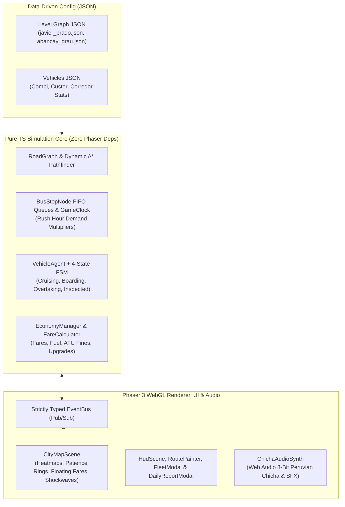
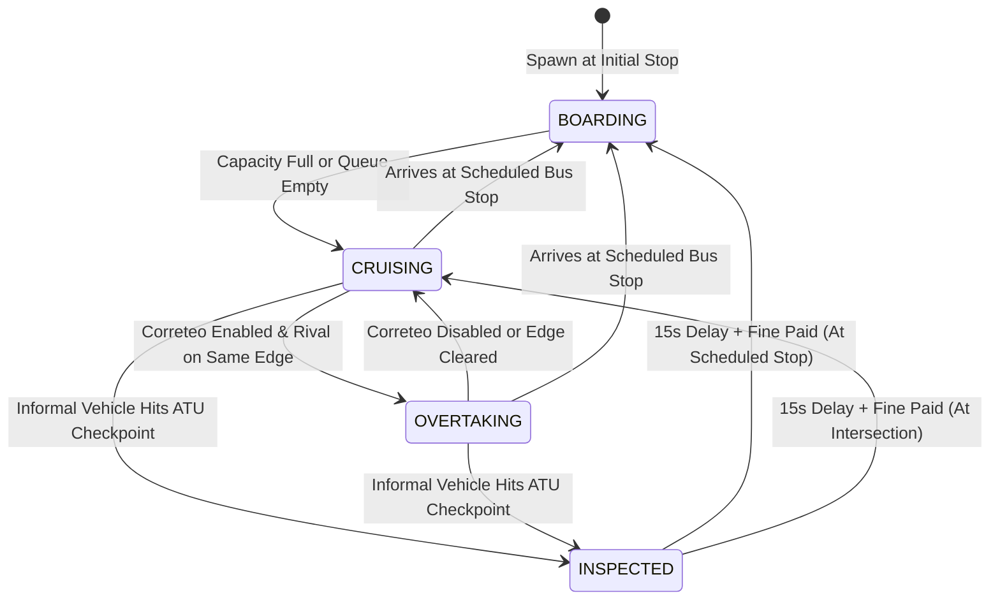

# LimaCaos: Combi Tycoon (`lima-chaos`)

> **A 2D top-down real-time urban transit strategy and arcade simulation game set in Lima, Peru.**
> Manage an informal-to-formal transit fleet (*Combis*, *Cústers*, *Corredores*) across iconic congested avenues (*Javier Prado*, *Abancay - Grau*), compete against rival AI lines via *"Correteo"*, reroute around traffic jams and *ATU* checkpoints, and balance daily cashflow before passenger patience runs out.

---

## 1. Architectural Golden Rule: Simulation vs. Presentation

The codebase enforces strict decoupling between the **Pure TypeScript Simulation Engine** (`src/simulation/`) and the **Phaser 3 WebGL Presentation Layer** (`src/scenes/`, `src/ui/`):

- **Zero Phaser Imports in `src/simulation/`**: All graph mathematics, dynamic $A^*$ pathfinding, BPR congestion curves, passenger demand queues, economy accounting, and vehicle Finite State Machines (FSM) are written in pure, deterministic TypeScript.
- **Headless Determinism**: Seeded via a Mulberry32 PRNG (`src/core/Random.ts`), an entire 18-hour Lima operating day (`05:00` – `23:00`, `1080` ticks) executes in memory in **under 30 milliseconds** via Vitest.



---

## 2. Graph Theory & Dynamic $A^*$ Pathfinding

### Directed Multigraph (`src/simulation/graph/RoadGraph.ts`)
Lima corridors are modeled as a directed multigraph $G = (V, E)$ where:
- **Vertices ($V$)** represent either `BUS_STOP` stations (with FIFO passenger queues and base spawn rates) or signalized `INTERSECTION` nodes (controlled by deterministic `TrafficLight` phase cycles: Green, Yellow, Red).
- **Edges ($E$)** represent directed avenue segments, including parallel **Main Lanes** (`isAuxiliary: false`) and **Auxiliary Bypass Roads** (*Vía Auxiliar*, `isAuxiliary: true`).

### Dynamic $A^*$ Edge Cost Formula (`src/simulation/graph/Pathfinder.ts`)
Whenever a `VehicleAgent` departs a stop or reaches an intermediate intersection, it evaluates the optimal path to its next scheduled stop using a dynamic $A^*$ cost function incorporating the quadratic **Bureau of Public Roads (BPR)** congestion curve and an **ATU Checkpoint Evasion Penalty**:

$$\text{Cost}(e, v) = \frac{L_e}{S_e \cdot M_v} \cdot \left(1 + 2.5 \cdot \left(\frac{N_e}{C_e}\right)^2\right) + P_{\text{ATU}}(e, v)$$

Where:
- $L_e$: Edge length in meters (`lengthMeters`).
- $S_e$: Free-flow base speed of the edge (`baseSpeedKmh`).
- $M_v$: Vehicle archetype speed multiplier (`speedMultiplier`).
- $N_e / C_e$: Current active vehicles on edge $e$ divided by edge capacity (`capacity`).
- $P_{\text{ATU}}(e, v)$: Returns `9999` if edge $e$ has an active ATU checkpoint, the vehicle lacks a formal permit (`hasLegalPermit === false`), and the route's *"Evade ATU Checkpoints"* doctrine is enabled; otherwise `0`.

---

## 3. Vehicle Agent Finite State Machine (`src/simulation/fsm/`)

Each `VehicleAgent` is driven by a 4-state Finite State Machine:



1. **`CruisingState`**: Advances along the current directed edge at the BPR congestion-adjusted speed, deducting fuel costs per meter and respecting red traffic lights at intersections.
2. **`BoardingState`**: Immediately alights passengers whose destination matches the current stop, then boards waiting passengers in FIFO order (`boardingSecondsPerPassenger`, reduced by **40%** when the *"Garganta de Lata"* Cobrador upgrade is active).
3. **`OvertakingState` (*"Correteo"*)**: Boosts speed by **+30%** (`1.30x`) to overtake rival combis on the same edge before reaching the next stop, at the cost of **+45%** fuel consumption (`1.45x`).
4. **`InspectedState`**: Detains informal vehicles (`hasLegalPermit === false`) at active ATU checkpoints for `15` simulation seconds and triggers the `S/ 120` fine.

---

## 4. Peruvian Transit Slang Glossary

| Term | In-Game Meaning |
| :--- | :--- |
| **Combi Pirata** | High-speed (`1.25x`), low-capacity (`16 pax`) informal van vulnerable to ATU checkpoint fines (`S/ 120`). |
| **Cúster Chicha** | Medium-capacity (`32 pax`) transit bus with formal operating permit (`hasLegalPermit: true`). |
| **Corredor Azul** | High-capacity (`65 pax`) formal metropolitan bus with fast multi-door boarding (`0.6s/pax`). |
| **China / Luca / Directo** | Distance-based fare tiers calculated by `FareCalculator`: *China* (`S/ 0.50`), *Luca* (`S/ 1.00`), *Luca China* (`S/ 1.50`), *Dos Lucas* (`S/ 2.00`), and *Directo* (`S/ 3.00`). |
| **Correteo** | Aggressive street-racing maneuver between rival transit lines to snatch waiting passengers at the next stop. |
| **Garganta de Lata** | Veteran *Cobrador* (fare collector) upgrade that cuts passenger boarding time by **40%**. |
| **Operativo ATU** | Surprise inspection checkpoint spawned on main avenues for 3 in-game hours (`180` minutes). |

---

## 5. Development, Testing & Build

```bash
# Install dependencies
npm install

# Run strict TypeScript typechecking
npm run typecheck

# Run headless Vitest simulation & graph unit tests
npm test

# Start local Vite development server
npm run dev

# Build production WebGL bundle into dist/
npm run build
```
